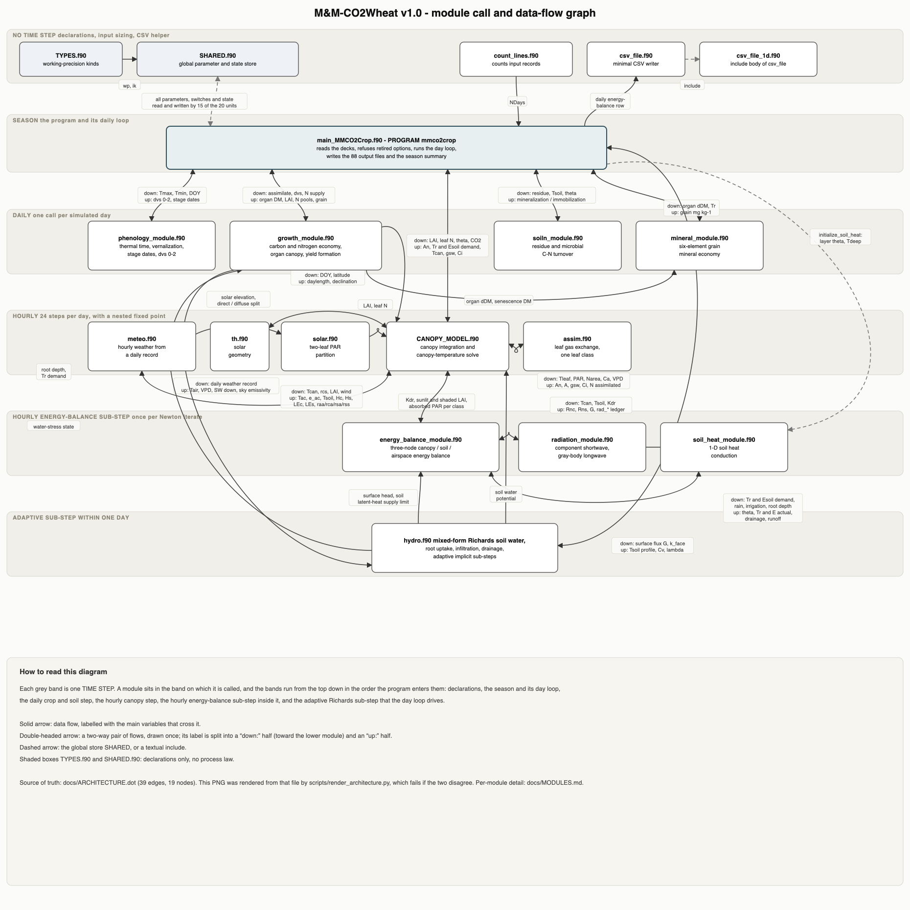

<!-- Copyright (c) 2018-2026 David Helman and The Hebrew University of Jerusalem -->
<!-- Licensed under the M&M-CO2Crop Research Licence v1.0 (see LICENSE): non-commercial research use with citation; redistribution of modified versions and commercial use require the copyright holders' consent. -->

# M&M-CO2Wheat v1.0

M&M-CO2Wheat v1.0 is a mechanistic, point-scale wheat model in which carbon, nitrogen,
water and energy are solved as one coupled system rather than as separate modules joined
by prescribed factors: a three-node canopy / soil / canopy-airspace surface energy balance
whose canopy airspace is a solved node, hourly two-leaf-class Farquhar-Busch photosynthesis
with Leuning stomatal conductance, a one-dimensional mixed-form Richards soil-water solver
with van Genuchten-Mualem hydraulics and Feddes root uptake, one-dimensional soil heat
conduction, a daily organ-level carbon and nitrogen economy in which every structural
increment is paid for in reduced nitrogen, residue and mineral soil nitrogen, and a
six-element grain mineral economy. It was built to predict how wheat yield **and grain
quality** respond to elevated CO2, water supply, temperature and nitrogen supply, and to
be falsified against field data rather than fitted to it. One executable runs every site
and treatment; site, season and cultivar differences enter only through documented input
values. The model is described in Part 1 of the companion papers and evaluated at three
wheat FACE experiments in Part 2.

`M&M-CO2Crop` is the name of the model family; `M&M-CO2Wheat v1.0` is this wheat release.

---

## Contents

| path | what it is |
|---|---|
| `*.f90`, `Makefile` | the model: 19 source files and the only build file |
| `INPUT_GUIDE.md` | the input manual — every input file, its format and units, and every driver record |
| `testcase/` | the Part 1 reference simulation, with its inputs, its 88 expected outputs and its checksums |
| `tools/compare_outputs.py` | compares your results against the shipped expected ones |
| `scripts/release_acceptance.py` | the 42-deck release acceptance harness |
| `scripts/render_architecture.py` | regenerates `docs/ARCHITECTURE.png` from `docs/ARCHITECTURE.dot` |
| `docs/MODULES.md` | per-module reference |
| `docs/ARCHITECTURE.png`, `.dot` | the module call and data-flow diagram and its source |
| `docs/FILE_INVENTORY.md` | every file that ships, every input, and all 88 outputs, one line each |
| `docs/V1_KNOWN_LIMITATIONS.md` | the optional diagnostics that v1.0 cannot produce, with the record and the file name of each |
| `LICENSE`, `CITATION.cff` | licence and machine-readable citation |

---

## Dependencies, and the versions this release was tested with

The model itself needs only a Fortran compiler and `make`. Python is needed only for the
comparison and acceptance tools, and only the standard library is used — no NumPy, no
pandas, no netCDF, no MPI, no external library of any kind.

| dependency | needed for | version this release was built and tested with |
|---|---|---|
| gfortran | the model | **GNU Fortran (Homebrew GCC 9.3.0) 9.3.0** at `/usr/local/bin/gfortran`; an x86_64 binary, so on this arm64 host it runs under Rosetta 2 and emits x86_64 code |
| make | the build | **GNU Make 3.81** |
| python3 | `tools/compare_outputs.py`, `scripts/release_acceptance.py` | **Python 3.7.7** (both tools need 3.6 or newer) |
| operating system | — | **macOS 26.6.2 (build 25G83)**, `uname -m` = `arm64` (Apple silicon), the compiler running under **Rosetta 2** |

Every version above was read from the tools themselves on the release machine
(`gfortran --version`, `make --version`, `python3 --version`, `sw_vers`, `uname -m`,
`file $(which gfortran)`) on 2026-10-21, not quoted from a note.

Not installed on that machine, and therefore not required: Graphviz, matplotlib, PyYAML.
Where one of them would normally have been used, the substitute is stated in place — see
"Architecture diagram" below and the note on `CITATION.cff` in "Citation".

---

## Building

```
make
```

That is the whole build. It compiles the 19 objects in dependency order and links the
executable `mmco2crop` in the current directory, with the flags the `Makefile` sets and
this release was tested with:

```
switch = -O3 -Wall      FFLAGS = -I/usr/local/include      FLINK = -L/usr/local/lib
```

The build takes well under a minute. **Compiler warnings are normal and expected** —
unused variables, unused dummy arguments, and linker notes about duplicate system
libraries; none of them is an error. What matters is that `make` finishes with exit
status 0 and that `mmco2crop` exists.

`make clean` removes the objects, the module files and the executable.

Do not change the optimization level if you intend to compare against the shipped
expected outputs: a different optimization level is a different environment, in the sense
made precise under "Verifying a run".

---

## Running the test case

The shipped test case is **the Part 1 reference simulation**: the WheatDryFACE 2024/25
experiment, cultivar Ruta, ambient CO2, well-watered (`WDF25_Ruta_aCO2_WW`). From the
directory that holds the `Makefile`:

```
make
mkdir -p run && cp -R testcase/input run/ && mkdir -p run/output \
  && (cd run && ../mmco2crop > run.log 2>&1; echo "exit=$?" >> run.log) \
  && tail -1 run/run.log
```

The last line printed should be `exit=0`; the run takes well under a minute and writes 88
files into `run/output/`.

Two things about that command are not optional. The model opens its inputs by the
**relative** path `input/...` and writes to the **relative** path `output/...`, so it has
to be started from inside a case directory; and it does **not** create `output/`, so the
directory must exist first. The command does both, and works on a copy in `run/` so that
`testcase/` itself is never written to.

To run your own case, build a directory with your own `input/` and an empty `output/` and
run the executable from inside it. What `input/` must contain is in `INPUT_GUIDE.md`.

---

## Verifying a run

```
python3 tools/compare_outputs.py run/output testcase/output
```

For every file this reports byte identity or, where the file is not identical, the maximum
absolute and the maximum relative difference of each numeric column together with the data
row at which each maximum occurs; then a summary table ordered worst first and a count per
verdict class. In a matched environment it ends with:

```
88 of 88 expected file(s) byte-identical.
VERDICT: byte-identical reproduction of the reference case.
```

The console log can be compared as well, with `cmp run/run.log testcase/run.log`. Note
that `testcase/run.log` was produced by the current build and differs from the frozen
reference run by exactly 24 removed debug lines; `testcase/README.md` explains why.

There is also a 42-deck acceptance harness, `scripts/release_acceptance.py`, which runs
every release deck of a sealed reference package and reports how many output files are
identical, differing, missing or extra. It is the gate every release commit had to pass
and needs that sealed package, so it is of use mainly to someone re-verifying the release
itself.

### The two tolerance statements

These are two different claims and must never be blurred into one.

**1. In a matched environment, reproduction is byte-for-byte, and that was measured
here.** A matched environment means the same compiler, the same compiler version, the
same optimization flags and the same platform — concretely, the row of versions in
"Dependencies" above. In that environment all 88 output files of the reference case are
reproduced byte for byte. This is not an expectation: it is the result of the release
acceptance gate, which required all 42 release decks to exit 0 and all 3 696 output files
to be byte-identical to the frozen reference package, and which was re-run on every
commit of the release clean-up.

**2. On a different compiler, compiler version, optimization level or platform, byte
identity is NOT expected.** Different
compilers and versions legitimately reorder floating-point operations, contract
multiply-add pairs differently and evaluate intrinsics to different last bits; in a
season-long iterative simulation those last-bit differences grow. **No measured
general cross-platform tolerance can be quoted for this model**: one further
platform has been measured, and a single second platform does not define a tolerance.
That measurement is reported in Part 1, Sect. 13.3: the frozen source compiled with
gfortran 13.3 on Linux x86-64 reproduces the reference package produced here on macOS
(Apple silicon) with 55 of the 88 output tables byte-identical, the harvest states of
yield components, nitrogen and minerals agreeing to print precision, the conservation
residuals differing at the 10^-15 level, and two diagnostic columns differing on single
days at the 1 % level. Treat that as one data point on compiler sensitivity, not as a
tolerance to test against. `tools/compare_outputs.py` exists precisely
to quantify whatever difference you actually get: run it and read the numbers it prints.
A difference it reports on a different compiler is information about compiler
sensitivity, not evidence that your installation is wrong, and the right response is to
report the numbers rather than to adjust anything.

---

## The source files

Nineteen files are compiled. `TYPES.f90` and `SHARED.f90` carry declarations only;
`csv_file_1d.f90` is an `include` body rather than a separate program unit. Build order is
the `OBJS` line of the `Makefile`.

| file | what it does |
|---|---|
| `TYPES.f90` | declares the working-precision kinds `wp` and `ik` with which every model variable is declared |
| `SHARED.f90` | the single global store: physical constants, measured parameters with their sources, the 183 driver switches, every prognostic pool and diagnostic ledger, and six small helper routines |
| `csv_file.f90` | minimal CSV writer; a reduced form of Arjen Markus's public-domain module, keeping only the double-precision routines the model calls |
| `csv_file_1d.f90` | the `include` body of that module's array write routine |
| `count_lines.f90` | counts an input file's records so the daily arrays can be allocated before reading |
| `th.f90` | solar declination, sunrise time and daylength for the day, at the site latitude |
| `solar.f90` | two-big-leaf radiation geometry: beam and diffuse extinction, sunlit and shaded leaf area, absorbed PAR per class |
| `meteo.f90` | expands one daily weather record into hourly forcing: irradiance, air temperature, humidity, vapour pressure deficit, sky emissivity |
| `radiation_module.f90` | component shortwave split by Beer's law and gray-body sky-canopy-soil longwave radiosity; net radiation of canopy and of soil |
| `soil_heat_module.f90` | one-dimensional soil heat conduction with de Vries heat capacity and Johansen conductivity; backward Euler solved by the Thomas algorithm |
| `soiln_module.f90` | residue and microbial carbon-nitrogen turnover; whether each pool's decay mineralizes or immobilizes nitrogen |
| `assim.f90` | leaf gas exchange for one leaf class in one hour: Farquhar-Busch photosynthesis, Leuning conductance, optional leaf water potential |
| `energy_balance_module.f90` | the three-node canopy / soil / canopy-airspace energy balance, solved by damped Newton iteration on a numerical 3x3 Jacobian |
| `hydro.f90` | mixed-form Richards soil water over ten layers in adaptive implicit sub-steps, with Jackson root distribution and Feddes uptake reduction |
| `mineral_module.f90` | the six-element grain mineral economy: solution concentration, uptake, allocation, remobilization and a per-element mass balance |
| `phenology_module.f90` | thermal time with vernalization and photoperiod, the eight stage dates, and the continuous 0-2 development stage the growth laws run on |
| `CANOPY_MODEL.f90` | the hourly canopy integration: a bracketed canopy-temperature root-find around a nested assimilation / conductance / vapour-deficit fixed point |
| `growth_module.f90` | the daily carbon and nitrogen economy: partition, respiration, leaf area, the stem reserve, nitrogen payment and turnover, grain number and kernel mass, root descent |
| `main_MMCO2Crop.f90` | `PROGRAM mmco2crop`: reads the decks, refuses retired driver options, runs the daily loop and its closures, writes the 88 output files and the season summary |

Each file carries a release header stating the same thing, plus what it calls, what calls
it, what it produces and which module consumes each product. `docs/MODULES.md` collects
all nineteen.

---

## Inputs

A run reads up to thirteen files from its `input/` directory, nine of them mandatory. The run-control file
`input/driver_main.txt` is **positional**: 183 records, one value per line followed by an
optional `!` comment, and record 1 names the weather file. Never delete or renumber a
record — retired records keep their position and are marked RESERVED, because removing one
silently reassigns every switch below it.

| file | what it carries |
|---|---|
| `input/driver_main.txt` | the 183 positional run-control records: site, canopy, soil, CO2, and every process switch |
| the weather file named by record 1 | daily weather: year, month, day, sunrise hour, Tmax, Tmin, RHmax, RHmin, wind, precipitation, irrigation, radiation |
| `input/driver_swtr.txt` | soil-profile setup: hydraulic file path, Richards sub-steps, initial root depth, water-table flag, layer count, initial water content and layer boundaries |
| `input/SoilLayer_vgm.csv` | per-layer van Genuchten-Mualem parameters |
| `input/tsoil_init.csv` | measured initial soil temperature anchors. Optional: absent means the driver record-50 initialization |
| `input/phenology_cultivar.txt` | cultivar phenology, the sowing date, the observed stage anchors, the bootstrap organ masses and nitrogen fractions, and the optional canopy traits |
| `input/cultivar_yield.csv` | cultivar yield coefficients (fruiting efficiency, potential kernel mass, chaff share, and two optional pairs) |
| `input/driver_N.csv` | the soil and plant nitrogen parameters, read positionally |
| `input/driver_minerals.csv` | one row per mineral element, 21 columns |
| `input/N_fertilizer.csv` | fertilizer applications, with an optional form keyword |
| `input/N_organic_treatments.csv` | organic residue and amendment events, including pre-sowing ones. Optional: absent, or a count of 0, is the no-residue baseline |
| `input/cultivar_partition.csv` | the leaf partition window. Optional: absent means the WOFOST baseline defaults, and the run says so |

**`INPUT_GUIDE.md` is the manual**: it gives each file's exact format and units, says which
entries are mandatory and which have a documented default and where that default comes
from, and lists every one of the 183 driver records with the values v1.0 accepts. Read it
before building a deck of your own. A value whose code the release does not contain is
refused at startup with the record number, the record name, the offending value and the
implemented set, and a non-zero exit status — the model never falls through to a different
mechanism.

---

## Outputs

A run writes **88 CSV files** into `output/`, each with a header row, plus the season
summary on standard output (the run command above captures it as `run.log`). They cover
the daily and hourly energy balance, radiation and aerodynamics; the soil water profile,
its ledger and the Richards solver trace; gas exchange and leaf temperature; phenology,
carbon partition and growth; the organ-level canopy chronology; the stem reserve; grain
number, kernel mass and grain filling; the soil and plant nitrogen economy; and the
six-element grain minerals.

`docs/FILE_INVENTORY.md` lists all 88 with one line each on content and units, grouped by
topic, together with the input files and everything else that ships.

Seven optional diagnostic files cannot be produced by v1.0, because the driver settings
that selected them are refused: they are named, with their records,
in `docs/V1_KNOWN_LIMITATIONS.md`.

---

## Architecture diagram



`docs/ARCHITECTURE.png` shows the nineteen modules as boxes grouped into bands by time step
— no time step, season, daily, hourly, the hourly energy-balance sub-step, and the
adaptive Richards sub-step — with arrows for data flow labelled with the main variables
that cross them.

`docs/ARCHITECTURE.dot` is the **source of truth** for that picture. Graphviz is not
installed on the machine this release was prepared on, and neither is matplotlib, so the
PNG was **not** produced by `dot` and **not** by matplotlib: it was rendered by
`scripts/render_architecture.py`, which parses the `.dot` file, refuses to draw unless its
own layout contains exactly the nodes and edges the `.dot` declares, writes an SVG, and
converts that SVG to PNG with the macOS system thumbnailer `/usr/bin/qlmanage`. The script
uses the Python standard library only. With Graphviz available the same graph can be
rendered directly:

```
dot -Tpng docs/ARCHITECTURE.dot -o docs/ARCHITECTURE.png
```

---

## Citation

If you use this software, or results obtained with it, cite both companion papers:

> Helman, D. (2026). M&M-CO2Wheat v1.0: A fully mechanistic coupled
> carbon–nitrogen–water–energy wheat model with a closed canopy energy balance — Part 1:
> Model description. *Geoscientific Model Development* (submitted; **DOI pending**).
>
> Helman, D. (2026). M&M-CO2Wheat v1.0 — Part 2: Model evaluation against three wheat
> free-air CO2 enrichment (FACE) experiments. *Geoscientific Model Development*
> (submitted; **DOI pending**).

The WheatDryFACE experiment and its measurements:

> Mulero, G., Bonfil, D., Lerner, G., Tamata, E., Egorov, F., Harris, Y., Michael, Y., Usenko, D.,
> and Helman, D. (2026a). WheatDryFACE: Design, performance, and insights from a multifaceted
> Mediterranean dryland wheat free-air carbon dioxide enrichment (FACE) platform. *Field Crops
> Research*, in review; preprint https://doi.org/10.2139/ssrn.6719421.
>
> Mulero, G., Bonfil, D. J., and Helman, D. (2026b). Where does the carbon go? Elevated CO2
> amplifies photosynthesis under high nitrogen but not yield in dryland Mediterranean wheat.
> *Plant, Cell & Environment*, under review; preprint https://doi.org/10.2139/ssrn.6879639.
>
> Helman, D., Mulero, G., and Tamata, E. (2026). Elevated CO2 increases leaf temperature
> independently of stomatal regulation. Research Square [preprint],
> https://doi.org/10.21203/rs.3.rs-9493050/v1.

Zenodo records: this package https://doi.org/10.5281/zenodo.23687586; the reference outputs of
the 38 decks https://doi.org/10.5281/zenodo.23688770; the WheatDryFACE observation tables read by `paper_scripts/` https://doi.org/10.5281/zenodo.23688951.

`CITATION.cff` carries the same information in machine-readable form, with `doi: TBD` on
both entries and a note on each saying that the string is a placeholder to be replaced
with the assigned DOI on acceptance. PyYAML is not installed on the release machine, so
the file could not be validated with it; it was parsed instead by a hand-written check of
the YAML subset it uses (indentation-based block mappings and sequences, quoted scalars,
no tabs, no CRLF, no duplicate keys), which reports 18 top-level keys and the required CFF
fields present.

---

## Observation data in this package

Some deck inputs are **observations**, not model settings, and they are not covered by the
software licence below. They are a subset of the **processed** observations of the papers:
treatment means and standard deviations, campaign-date means, and daily ring-mean series.
**No plot-level observation is included in this archive** — verified file by file on
2026-10-26 over both the deck inputs and the 23 tables under `paper_scripts/observations/`:
not one carries a plot, ring or replicate identifier column.

| file | what it holds | level |
|---|---|---|
| `input/site_observed_targets.csv` | the agronomic and gas-exchange targets of the reference simulation | treatment means from the published supplement tables |
| `input/site_observed_phenology.csv` | observed stage calendar | mean day after planting with its standard deviation |
| `input/tsoil_init.csv` | initial soil temperature | mean over the replicate rings, with the excluded faulty ring named |
| `paper_scripts/observations/braunschweig/BRAUNSCHWEIG_*_obs.csv` (16 files) | the Braunschweig growth, nitrogen, soil-moisture and phenology record, long format | treatment means with sample standard deviation and the number of rings |
| `paper_scripts/observations/maricopa/*.csv` (6 files) | the Maricopa harvest end points, replicate dispersion, soil moisture, dated growth and hourly energy balance | treatment means with standard deviation and replicate count |
| `paper_scripts/observations/obs_registry_braunschweig_maricopa.csv`, `consolidated_obs_braunschweig_maricopa.csv` | the observed scalars the evaluation registers for those two sites | treatment means with standard deviation and the source of each row |

**Provenance and licence of these files.** The WheatDryFACE observations are described by
Mulero et al. (2026a, 2026b) and are archived as a separate Zenodo data set **under CC BY
4.0**; that record, not this one, is the citable source, and it holds the complete processed
set for every variable of Part 2, Table 2 — including the LI-600 porometer record. No
WheatDryFACE observation file is added by `paper_scripts/`: the scripts read them from the
`OBS_DIR` the reader supplies from that deposit (the porometer record is read there for
Supplement S2, Fig. S8). The 23 files under `paper_scripts/observations/` are the
Braunschweig and Maricopa tables only, derived from the two open data sets named below and
documented file by file in `paper_scripts/observations/README_observations.md`. The Maricopa observations are the open data
set of Kimball et al. (2017) with its associated workbooks; the Braunschweig observations are
the open data set of Manderscheid et al. (2020).

**Plot-level data are under embargo until 1 January 2029** and are available from the author
on reasonable request before that date. They are deliberately absent here, and nothing in
this archive should be read as releasing them.

---

## Licence

**M&M-CO2Crop Research Licence v1.0** — see `LICENSE`, the authoritative text. It covers
the **software**: the Fortran source, the `Makefile`, the tools and scripts, and the
documentation of this archive. It does **not** cover the observation files listed under
"Observation data in this package" above, which carry the licence of their own source
archive. Those terms are, by source: the WheatDryFACE observations **CC BY 4.0**; the
Braunschweig tables under `paper_scripts/observations/braunschweig/` are aggregated from
Manderscheid et al. (2020), doi 10.18174/odjar.v6i0.16397, **CC BY 4.0**; the Maricopa
tables under `paper_scripts/observations/maricopa/` are derived from the Harvard Dataverse
deposit doi 10.7910/DVN/YRTQ3Z of Kimball et al. (2017), **CC0 1.0**. The two
`observations/*_braunschweig_maricopa.csv` tables mix both and follow the stricter, CC BY 4.0. In short, for the software:
non-commercial research and teaching use is free, with citation of the two papers above;
redistribution in any form, original or modified, needs the copyright holders' written
consent; commercial use needs a separate licence; the software comes with no warranty; and
reading the source for scientific review, replication and verification is permitted
without restriction.

SPDX-style identifier used in `CITATION.cff`: `LicenseRef-MMCO2Crop-Research-1.0`.

Copyright (c) 2018-2026 David Helman and The Hebrew University of Jerusalem.

---

## Contact

David Helman — <david.helman@mail.huji.ac.il> — The Hebrew University of Jerusalem.
